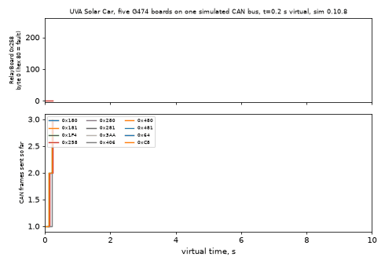
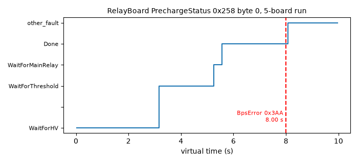
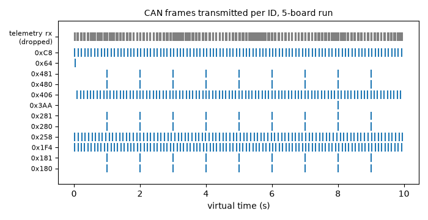
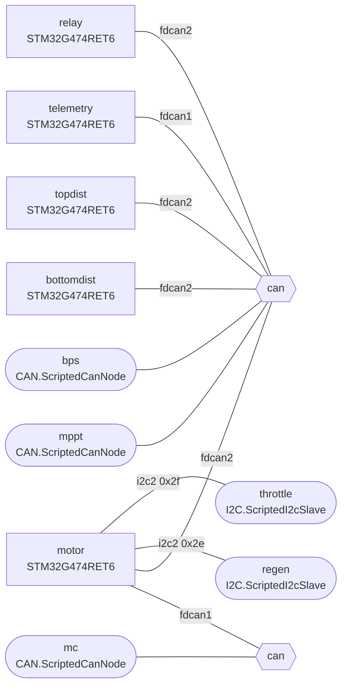

<!-- simantic-banner -->
> **Run this firmware with no hardware.** [Simantic](https://simantic.com) simulates the whole board, peripherals, sensors and buses included. Try it free at **[simantic.com](https://simantic.com)**, or run it locally: `curl -fsSL https://simantic.com/install | sh`

> **[Simantic](https://simantic.com)** runs this firmware on simulated hardware, no board needed. Try it at [simantic.com](https://simantic.com).

## This fork: the car in a simulator

This is Simantic's fork of the UVA Solar Car firmware, kept as a simulation showcase. It runs the
team's firmware, **unmodified**, for five STM32G474 boards on one simulated CAN bus: no boards, no bench.

**Please read first.** This repository has no license, and its own README says use elsewhere is not
recommended. The fork therefore adds nothing to the firmware: only the `sim/` directory and this section.
It is not connected to the upstream repository for pushes, and nothing here is offered back or
published upstream. If you are on the team and want this removed, say so and it goes.

```
RelayBoard, the precharge sequence (CAN id 0x258, byte 0 = motor stage | mppt stage << 3)
  0.022 s  data=00 FF 1F ...   waiting for high voltage, no pack voltage yet
  0.130 s  data=00 93 13 ...   BMS status seen: pack 100.0 V, threshold 915 mV
  3.159 s  data=12 93 13 ...   waiting for threshold
  5.249 s  data=1B 93 13 ...   waiting for main relay
  5.561 s  data=24 93 13 ...   done
  8.073 s  FAULT RelayBoard/Src/Precharge.cpp:129: Precharge disabled due to fault
  8.078 s  data=80 93 13 ...   other_fault, after the BMS sends a weak-cell fault at 8 s
```

That excerpt is from `sim/run.sh`, taken from the frame capture and the RelayBoard's own log line.



The five-board run (`sim/scenario.yaml`, 10 virtual seconds) as a dashboard: every number is decoded, with the
team's own `Common/can_structs` definitions, from a CAN frame a board transmitted in the run, and the console pane
is the boards' own UART log. Simulated on Simantic sim 0.10.8, virtual time, playback 0.67x. The BMS peer's pack
voltage, current and SoC are the scenario's constants (`sim/peers/rivanna_bps.py`), and the pedal is not driven,
so the car is idle: the run shows the precharge sequence and the response to the BMS fault at 8.0 s, not driving.
Regenerate with `sim/run.sh && python3 sim/make_gif.py <sim-version>`.



RelayBoard's PrechargeStatus (0x258, byte 0) against virtual time, with the BMS peer's BpsError at
8.0 s marked. Configuration `sim/scenario.yaml` (five boards), 10 virtual seconds, Simantic `sim` 0.10.0
(build f219eb31), 2026-11-15, drawn from the run's `--frames` capture.



Every frame transmitted in the same run, one row per CAN ID.

**Corrected 2026-11-16.** An earlier version of this page said TelemetryBoard's FDCAN2 ran at 1 Mbit/s and
that the simulator dropped all 451 frames to it as `bit_rate_mismatch`, blaming a model or firmware
init-order gap. That was a wiring error in `sim/scenario.yaml`, not a model or firmware fault:
TelemetryBoard's CAN pins (PA11/PA12) are FDCAN1, and the firmware never initialises FDCAN2. The scenario
connected `telemetry.fdcan2`, which sat at its reset NBTP `0x06000A03` (NBRP=0, NTSEG1=10, NTSEG2=3 =
16 time quanta at the 16 MHz kernel clock = 1.000 Mbit/s, RM0440 section 44.4.7). The scenario now connects
`telemetry.fdcan1`, which the firmware programs to 250 kbit/s like the other four boards' FDCAN2.

**What runs:** five controllers, each on its own simulated STM32G474RET6, all on the same firmware tree.

| Board | Firmware | In the simulation |
| --- | --- | --- |
| RelayBoard | `RelayBoard` | boots, FDCAN2, precharge state machine, sends and receives CAN |
| MotorBoard | `MotorBoard` | boots, FDCAN1 and FDCAN2, throttle and regen potentiometers over I2C, sends and receives CAN |
| BottomDistBoard | `BottomDistBoard` | boots, sends pedal status, receives CAN |
| TopDistBoard | `TopDistBoard` | boots, receives CAN |
| TelemetryBoard | `TelemetryBoard` | boots, receives CAN (451 of 451 frames in 10 s), has no SD card, see the gaps below |

**The scenario**, as `sim graph --scenario sim/scenario.yaml` prints it. Square boxes are the simulated
MCUs running the firmware, rounded boxes are the modelled parts around them, hexagons are the CAN buses:



**Configurations tried:**

| Configuration | Where | Virtual | Wall | Result |
| --- | --- | --- | --- | --- |
| RelayBoard alone with BMS and MPPT peers | `sim/relay-only.yaml` | 10 s | 3.6 s | runs: 252 frames on the bus, precharge reaches Done at 5.48 s, fault at 8.07 s opens it |
| All five boards, one main bus plus the motor bus | `sim/scenario.yaml` | 10 s | 14 to 24 s, depending on machine load | runs; TelemetryBoard has no SD card, see below |

Both were run with Simantic's `sim` 0.10.0 (build f219eb31) on 2026-11-15 (five-board row re-run 2026-11-16 with the corrected scenario: 15 s wall, TelemetryBoard received 451 frames, no `bit_rate_mismatch` warnings), against firmware commit
`dd53492` built with the Arm GNU toolchain 15.2, Debug, `BOARD=STM32G474RET6`. In the five-board run the
buses carried 451 transmitted frames in 10 s: 100 MotorCommands (0xC8) from MotorBoard, 100 PedalStatus
(0x1F4) from BottomDistBoard, 96 PrechargeStatus (0x258) and 1 AuxBatteryStatus (0x64) from RelayBoard,
and the peers' BMS and MPPT frames. The two potentiometers on MotorBoard's I2C answered every write
(no "I2C write failed" lines).

The parts around the boards are Python models in `sim/peers/`, following the team's own CAN definitions
in `Common/can_structs`:
- **BMS** (`rivanna_bps.py`): BpsStatus 0x406 every 100 ms and one BpsError 0x3AA at 8 s.
- **MPPT** (`rivanna_mppt.py`): the 0x180/0x181, 0x280/0x281, 0x480/0x481 frames.
- **Motor controller** (`rivanna_motor_controller.py`): on MotorBoard's own CAN; stays silent because no
  board in this firmware sends it a request.
- **Throttle and regen pots** (`mcp4551.py`): the two I2C devices at 0x2F and 0x2E.

The BMS and MPPT periods and the 8 s fault are stand-ins chosen for the scenario (the definitions carry
no cycle times); each is marked as a simplification in the peer.

**Gaps, with the evidence:**
- **TelemetryBoard's SD card never mounts**: `SPI init failed: no matching peripheral for MOSI/MISO/SCK
  pins`, then `SD: mount failed`. Read from the source, the SD driver's file-scope SPI object claims SPI2
  before `app_main` builds a second one on the same pins. That is in the firmware, not the simulator, and
  it is left as is.
- **Bus bit timing in the firmware** (`fdcan.c`): `calculate_prescaler(&hfdcanN, 4000000, baud)` is called
  before NominalTimeSeg1/2 are assigned, and FDCAN is clocked from the 16 MHz HSI16, not 4 MHz. It yields
  250 kbit/s only because 4 MHz x 4 matches the 16 MHz clock; the boards read back 250 kbit/s, the rate they
  ask for. Reproduced, not fixed.
- **`Log Overflow`** is logged on every board that prints the BpsError line.
- No frame on the bus is a CAN-FD frame; the firmware uses classic CAN. Not run: DashboardCommands 0x12C
  is subscribed to by three boards and sent by none in this repository.

**Run it** (needs CMake, Ninja, the Arm GNU toolchain, and Simantic's `sim` on PATH):

```
sim/build.sh /path/to/arm-gnu-toolchain/bin    # builds the five images into sim/build/bin
sim/run.sh 10                                  # 10 virtual seconds; logs and frames in sim/out/
SCENARIO=sim/relay-only.yaml sim/run.sh 10     # RelayBoard alone
```

The firmware logs `__FILE__` paths, so the log lines carry the path of your checkout.

**Changes to the firmware: none.** `sim/build.sh` writes a copy of `cmake/arm-gcc.cmake` with your
toolchain path into `sim/build/` (the original hard-codes `/usr/bin`) and builds from that.

Everything below is the UVA Solar Car team's README.

---

# Rivanna3S
Codebase for the embedded code that runs on the Solar Car. Rivanna3S design cycle. <br>
This code was made by and for the Solar Car Team at UVA. Use elsewhere is not recommended. 

## Resources on the Team Wiki

Team Wiki: [https://solarcaratuva.github.io/](https://solarcaratuva.github.io/) <br>

**Compiling, Uploading, Logging**: [Embedded >> Compile, Upload, Monitor](https://solarcaratuva.github.io/Embedded/riv3_compile_upload.html) <br>
**Development Guide**: [Embedded >> Rivanna3S Development Guide](https://solarcaratuva.github.io/Embedded/riv3_dev_guide.html) <br>
**New Member Onboarding**: [Embedded >> Onboarding](https://solarcaratuva.github.io/Embedded/onboarding.html) <br>
... and more


## CAN Message Monitoring

For CAN-based advanced logging, debugging, and analysis, see the [CAN Message Logger](https://github.com/solarcaratuva/CANMessageLogger) project.

## Development

*These are recommendations*
- View and edit code using [VSCode](https://code.visualstudio.com/)
    - install the extensions: `Remote Extensionpack`, `C++ Tools Extensionpack`, `Docker`, `Python`
    - Windows Users: use these extensions to *remote* into where this repo is stored in WSL

